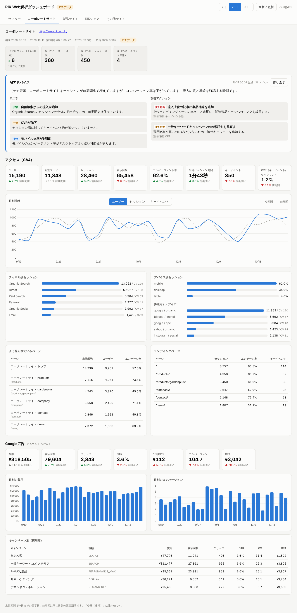

# RIK Web解析ダッシュボード

コーポレートサイト・製品サイト・RIKシェアなどの GA4、Google広告、Meta広告（Facebook・Instagram）のデータを API で自動取得し、サイトごとのタブで確認できるダッシュボードです。各サイトの数値をもとに Claude が改善アドバイスを出します。Cloudflare Workers 上で動き、Microsoft 365（Entra ID）のアカウントでサインインします。



## できること

- 期間は 7日 / 28日 / 90日（いずれも昨日まで）。比較は **直前と比較**（直前の同じ日数）と **前年と比較**（同じ日付の1年前）を切り替え
- **サマリー**タブで全サイトの主要指標を、GA4（サイトのアクセス）、Google広告、Meta広告に色分けして一覧
- **サイト別タブ**
  - 今日の速報（リアルタイムの閲覧者数、今日のユーザー・セッション・キーイベント）
  - AIのひとこと（サイト全体）
  - **サイトのアクセス解析（GA4）**: AIによる総評と改善アドバイス、主要指標の比較、日別推移、チャネル・デバイス・参照元、人気ページ、ランディングページ
  - **広告の成果（Google広告）**: AIによる総評と改善アドバイス、費用と成果（CPA・CVR・ROAS）、露出（CTR・CPC・検索インプレッションシェアと予算/ランクによる損失）、キャンペーン別の費用対効果と判定、デバイス別、キーワード、検索語句（除外候補の表示）、配信した広告（画像・見出しをキャンペーン別に表示。Google広告API接続時のみ）
  - **SNS広告の成果（Meta広告）**: AIによる総評と改善アドバイス、費用と成果（CPA・CVR・ROAS）、露出と反応（リーチ・フリークエンシー・CTR・CPC・CPM）、キャンペーン別の費用対効果と判定、配信面別（Facebook / Instagram など）、広告（クリエイティブ）別
- AIの総評は毎朝7時に「28日・直前比」を自動作成。画面のボタンで、表示中の期間・比較の分も作れます（生成中は進み具合を表示）。期間ごとに保存して全員で共有し、日付が変わると消えます
- 右下の「AIに質問」から、画面の見方や気になるデータについて自由に質問できます。表示中のサイト（サマリーなら全サイト）・期間の集計データ、診断、AIのひとことをもとに答えます。会話は保存せず、1人1時間60回まで。モデルは `ASK_MODEL`（未設定なら `ADVICE_MODEL`）で変更可

## 「開いた瞬間に最新」の仕組み

1. 30分ごとの定期実行で全サイトの 7日・28日分（直前と比較）を取得して KV に保存。90日と前年比は開いた時に取得
2. 画面を開くと KV のデータを即表示
3. 保存から10分以上たっていれば、そのまま API から取り直して画面を差し替え（「最新データを取得中…」表示）
4. リアルタイムの閲覧者数は常に GA4 Realtime API から直接取得（1分ごと）

GA4 の集計値は処理に数時間〜1日の遅れがあり、Google広告・Meta広告も数時間遅れます。そのため期間集計は昨日まで、当日分は「速報」として分けています。

## 構成

```
ブラウザ ─ Cloudflare Access（Entra ID でSSO）─ Worker ─┬─ GA4 Data API（サービスアカウント）
                                                         ├─ Google Ads API（OAuth + 開発者トークン）
                                                         ├─ Meta Marketing API（システムユーザーのトークン）
                                                         ├─ Claude API（AIアドバイス）
                                                         └─ KV（データとアドバイスのキャッシュ）
```

| パス | 内容 |
|---|---|
| `src/index.ts` | ルーティング、定期実行 |
| `src/service.ts` | レポート組み立て、キャッシュ |
| `src/google/ga4.ts` | GA4 Data API |
| `src/google/ads.ts` | Google Ads API（GAQL） |
| `src/meta/meta.ts` | Meta Marketing API（Insights） |
| `src/ai/advice.ts` | Claude によるアドバイス生成 |
| `src/access.ts` | Cloudflare Access のトークン検証 |
| `src/demo.ts` | 認証情報が揃う前のデモデータ |
| `public/` | 画面（HTML / CSS / JS） |

## セットアップ

[docs/SETUP.md](docs/SETUP.md) を参照してください。ターミナルを使わずブラウザだけで進める場合は [docs/SETUP-BROWSER.md](docs/SETUP-BROWSER.md) を参照してください。

## ローカルで動かす

```bash
npm ci
cp .dev.vars.example .dev.vars   # デモデータ・認証なしで起動する設定
npm run dev                      # http://localhost:8787
npm test
npm run typecheck
```
